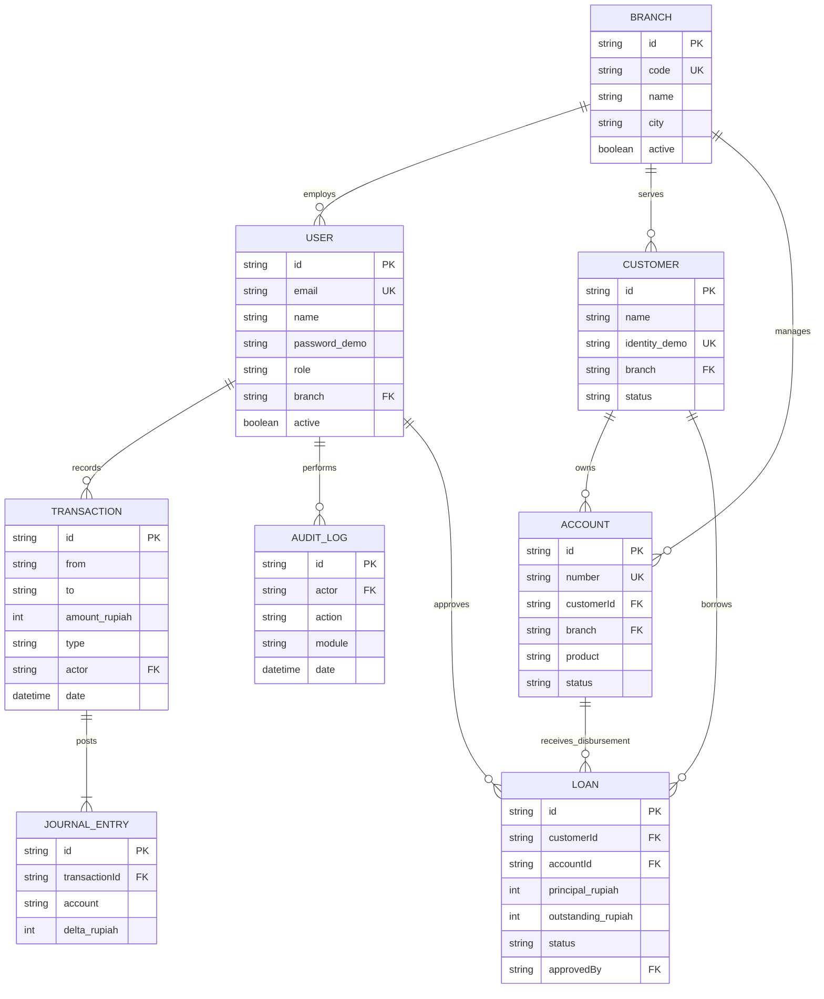

# Entity Relationship Diagram — MILALA BANK

ERD berikut adalah **model basis data konseptual** untuk kemungkinan backend di masa depan, bukan basis data aktif pada prototipe. Versi HTML saat ini menggunakan objek JSON LocalStorage.

**Perhatian:** `TRANSACTION.from`, `TRANSACTION.to`, serta `JOURNAL_ENTRY.account` dapat menunjuk rekening nasabah ataupun akun sistem simulasi (`GL-CASH`, `GL-LOANFUND`), sehingga model nyata harus menormalkan akun GL sebagai entitas tersendiri. `settings` dan `counters` disimpan sebagai metadata dokumen JSON versi prototipe.
