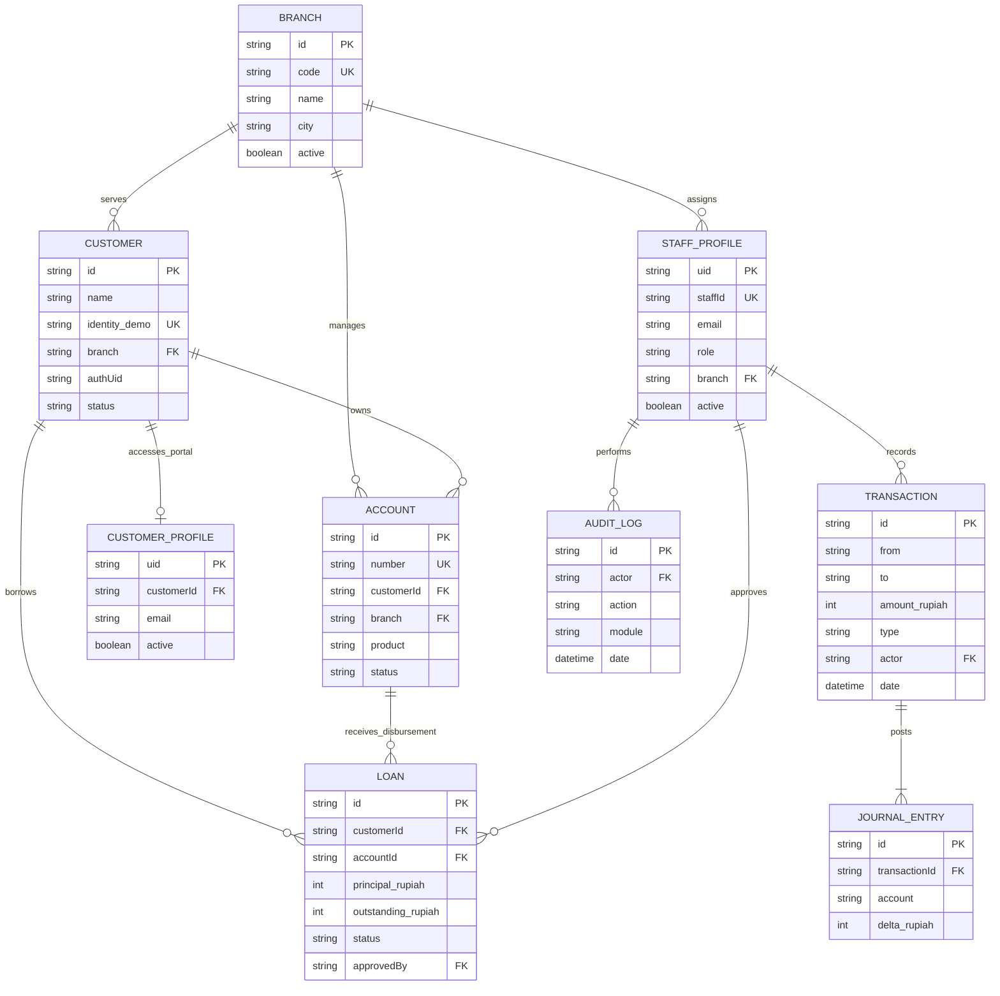

# Entity Relationship Diagram — MILALA BANK

Data bisnis lama tetap dipertahankan pada node `/milala_core_banking`. Browser tidak membaca atau menulis node ini secara langsung; Vercel Serverless Functions menggunakan Admin SDK setelah memvalidasi Firebase ID token, identitas, dan role.

## Node penting

- `/milala_core_banking`: data bisnis lama (nasabah, rekening, transaksi, jurnal, kredit, cabang, staf, audit, settings, counters).
- `/milala_secure/staffProfiles/{uid}`: pemetaan UID Firebase Auth ke ID staf dan role.
- `/milala_secure/customerProfiles/{uid}`: pemetaan UID Firebase Auth ke ID nasabah.
- `/milala_secure/pendingRegistrations/{uid}`: data registrasi sementara sebelum verifikasi email.

Tidak ada password plaintext di Realtime Database setelah migrasi. Kredensial disimpan dan diverifikasi oleh Firebase Authentication. Custom Claims role hanya ditetapkan oleh Admin SDK.

**Catatan:** `TRANSACTION.from`, `TRANSACTION.to`, dan `JOURNAL_ENTRY.account` dapat menunjuk rekening virtual ataupun akun sistem simulasi (`GL-CASH`, `GL-LOANFUND`). Ini tetap model ledger latihan, bukan general ledger bank produksi.
